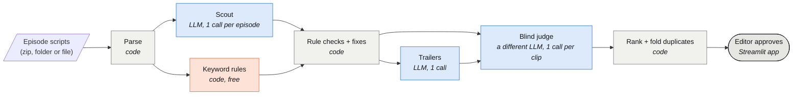

# Promo Finder

Reads microdrama screenplays and finds the best 20–60 second promo clips in them: clips that open on a hook in the first 3 seconds, cut on a cliffhanger, and make sense to someone who has never seen the show. Each promo comes out with the episode and exact start/end of every segment, the hook, the cliffhanger, a one-line reason, and a rank.

An editor still makes the final call. The tool does the first pass, so the editor reviews a ranked shortlist instead of watching 100 minutes of footage.

Built for Kuku's AI Generalist assignment (Problem 1). The 2-page solution doc is generated from a finished run with `python docs/build_doc.py <run_dir>` (needs Chrome or Edge to print the PDF). It's submitted separately and isn't committed, because it quotes the scripts.

## Run it

```bash
pip install -r requirements.txt
cp .env.example .env              # add a free GROQ_API_KEY (console.groq.com/keys); GEMINI_API_KEY optional

python -m promo_finder path/to/show.zip                  # whole show
python -m promo_finder path/to/show.zip --episodes 1-5   # quick test
python -m promo_finder path/to/show.zip --mode heuristic # no API key at all: keyword rules only

streamlit run app.py              # review app: open a finished run, or upload a new show
```

Input can be a folder of episode files, a `.zip` of them, or one file. The parser reads Kuku's screenplay format (a timestamp on every line), and falls back to subtitle files (`.srt`/`.vtt`) or any text whose lines start with a timestamp, like `[00:12.5 - 00:15.0] NAME: line`.

## Swapping the model

Every provider goes through one OpenAI-compatible client, so a swap is a flag:

```bash
--provider groq   --model qwen/qwen3.8-27b       # default scout
--provider gemini --model gemini-3.5-flash
--provider openai | anthropic | openrouter | ollama
--provider custom --base-url https://your-gateway/v1 --model your-model   # key in LLM_API_KEY

--judge-provider groq --judge-model openai/gpt-oss-120b                   # default judge
--judge-provider same                                                     # scout judges itself (cheaper, less honest)
--fallback groq:openai/gpt-oss-20b@low                                    # used when the scout's daily quota runs out
```

Every call is cached in `.cache/llm`, so a re-run only pays for what changed. Re-running the full 50-episode show from cache takes a few seconds and reproduces the original run exactly, including which fallback model scouted which episode.

## How it works



Blue = AI model, orange = keyword rules, grey = plain code. The models only ever pick *which* script lines; every timestamp, length and rule check is code.

1. **Parse (code).** Screenplay → beats with exact timestamps. Every beat gets an id (`B17`).
2. **Show cheat sheet (LLM, 1 call).** Premise and who's who (the scripts call one character "MYSTERIOUS BEARDED MAN", "THE BEARDED STRANGER" and "ALEXANDER").
3. **Two proposers.**
   - **Scout (LLM, 1 call per episode)** proposes up to 3 promos by beat id, plus short "moments" for trailers. The model never writes a timestamp; code turns ids into times.
   - **Keyword rules (code, free)** propose each episode's highest-intensity window (slap, blood, "!", angry delivery notes).
4. **Rule checks (code).** 20–60 s, hook within 3 s of the start, cut within 4 s of the cliffhanger. A broken pick goes back to the model once with the exact error and only the nearby beats. If that fails, code fixes it the way an editor would: it moves the cut to the nearest beat that leaves a question hanging, or opens earlier on the strongest nearby line when the moment is the episode's last beat. Cuts are snapped to camera-shot changes.
5. **Cross-episode trailers (LLM, 1 call)** stitched from the moments.
6. **Blind judge (a different LLM, 1 call per clip).** It sees only the clip as it plays from 00:00, as a genre fan who has never seen the show, and scores hook, cliffhanger, clarity and overall.
7. **Rank (code).** Weighted judge scores (weights in `pipeline.Config`), a small bonus for episodes 1–10, and folding of near-duplicates and of the same scene continuing across an episode break.

## Free-tier notes

Groq's free tier allows each model 8,000 tokens a minute and roughly 200k tokens a day. A show needs about 360k scout tokens, so one free model can't scout a whole show in a day. The client paces itself with a token bucket, stops immediately on a daily-quota error, and moves to the next `--fallback` model. Gemini's free tier stops at about 20 requests per model per day.

## What a run writes

`outputs/<show>/<run>/`:

| File | What it is |
|---|---|
| `report.md` | Ranked promos for a human: segments, hook, cliffhanger, why, blind-viewer notes, clip transcript |
| `promos_ranked.csv` | Same, one row per promo, including who proposed it (which model, or the rules) |
| `promos.json` | Everything, for the app |
| `baseline_heuristic.csv` | Everything the keyword rules found |
| `rejected.json` | Candidates that failed the rule checks, and why |
| `eval_vs_baseline.json` | From `python -m promo_finder.evaluate`: LLM vs rules, same blind judge |
| `raw/` | Every model call, unedited (prompt, response, tokens, latency, cached or not), per-episode JSON, retry/quota events |

## Results on the input pack (50 episodes)

60 distinct promos (33 from the LLM, 26 from the rules, 1 trailer), all 20–59 s. In a blind test on 20 episodes, the keyword rules' best pick scored 6.1/10 against the LLM's 5.75 (7 wins, 7 ties, 6 losses): a tie, which is why the rules became a second proposer instead of just a baseline. The whole show took 174 calls and about 514k tokens, roughly $0.25 at paid prices. The doc covers where it picks badly.

## Confidentiality

The input pack is Kuku's content. No scripts are committed: `.gitignore` blocks `*.txt`, `*.zip`, `data/` and `outputs/` (outputs quote the scripts in clip transcripts).
